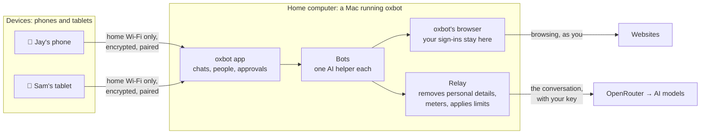
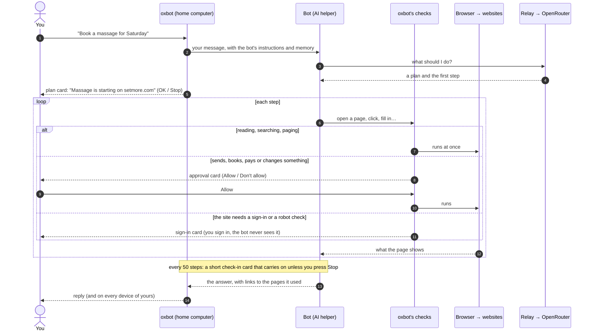
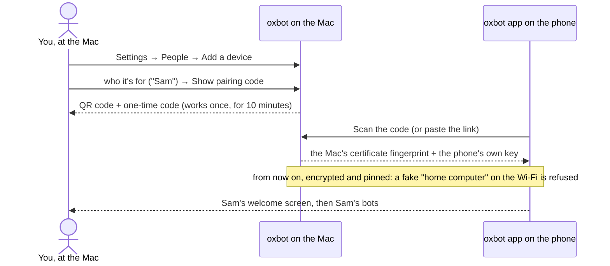
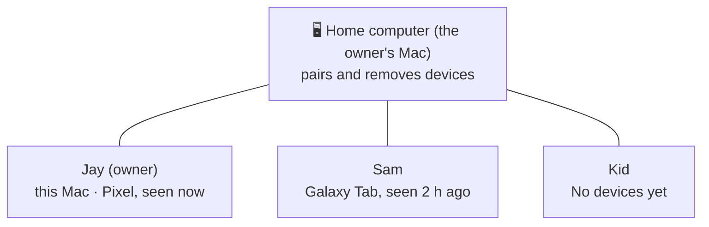

# oxbot

Always-on bots on your home computer (a Mac), used through the oxbot desktop app there and the
oxbot Android app on devices on your home Wi-Fi. Bots answer with free and paid AI models through
your home's OpenRouter account, free models first (see [AI models](#ai-models)). Model calls go
only to OpenRouter, or later to a model on this computer; nothing else: no relay servers, no push
services, no analytics, and nothing goes to Anthropic.



Everything lives on the home computer: bots, chats, the browser and its sign-ins, your AI key. Phones and
tablets are windows onto it. Only two things leave the Mac: a bot's conversation goes to OpenRouter
(personal details swapped out first), and the browser visits websites.

## What happens when you send a message



## Get oxbot

oxbot runs on a Mac with an Apple chip (M1 or later), macOS 13 or newer. That Mac becomes the
**home computer**; keep it plugged in.

1. Download `oxbot_<version>_apple-chip.dmg`, open it and drag **oxbot** to Applications. It's
   signed and notarized by Apple, so it opens with no warning. The browser, the AI helper (Codex)
   and Node.js are inside: nothing else to install.
2. Open oxbot. The welcome asks your name, signs you in to OpenRouter (the AI account, once),
   and offers to keep the Mac awake while it's plugged in.
3. Make a bot from the sidebar, or ask the Assistant to make one.

Until public downloads exist, build the .dmg yourself (see [Desktop app](#desktop-app)).

## Connect your devices

Phones and tablets use the home computer's bots over your home Wi-Fi. Each device belongs to one
person and acts as them: their own Assistant, their private bots, their approvals. A person can
have several devices; pair each one once.



1. **Install the app on the device.** Android: install the APK (see [Android app](#android-app-a-device));
   iPhone and Google Play are on the way.
2. **On the Mac:** oxbot → Settings → **People** → **Add a device**, type who it's for, then
   **Show pairing code**. (The sidebar's **Connect a device** opens the same place.) The Mac must
   be on the Wi-Fi the phone will use; pairing lets phones use that network.
3. **On the device:** open oxbot, tap **Scan the code** and point it at the QR code. No camera?
   Copy the link on the Mac and use **Paste the link instead**.
4. The device shows its person's welcome screen, then their bots. Repeat for each device.

A code works once, for 10 minutes, with a few tries. Only the home computer can pair devices.

## Manage devices



- **See them:** Settings → **People** lists each person with their devices and when each was last
  seen. **Devices** on a person's row opens their list.
- **Remove one:** **Remove**, then **Yes, remove**. The device is cut off at once; pairing it
  again needs a new code.
- **Away from home:** a device can't reach the Mac, by design (no relay, no cloud). It still
  shows its own copy of recent chats (the latest 300 messages per bot, 30 days) and the last 50
  reports it opened, and reconnects by itself back on home Wi-Fi.
- **A new phone:** remove the old one, then pair the new one.

| | Home computer | A device |
|---|---|---|
| Chat with bots, give tasks | ✓ | ✓ shared bots and its person's own |
| Approve cards | ✓ | ✓ for its person's tasks |
| Sign in to websites | ✓ the browser window | ✓ a live view of the sign-in page |
| Pair or remove devices | ✓ | |
| OpenRouter account and AI settings | ✓ | |
| The Mac's microphone, files on the Mac's screen | ✓ | |

## How oxbot works, in detail

Status: the desktop app on the home computer plus the Android app for devices (milestone
Foundations, issue #1). Shared bots share one home browser, oxbot's own Camoufox (a Firefox build
inside the app), minimized in the Dock, that keeps the websites you're signed in to: a bot that
needs an account asks, the browser comes forward on that site with the bots paused, you sign in
once and close that tab, and every bot on that browser stays signed in (a sign-in counts only if
it left a new cookie).
Settings → Sign-ins lists the websites you're signed in to (the sidebar's Signed in link opens
it); open one, or sign out of it alone. Bots take turns on the browser. oxbot checks every
browser step: links, tabs, search, filters, sorting and paging run at once; an approval request
comes before anything that changes something (Send, Post, Save, Apply, Allow, Enable, Block,
Leave, Add…, a POST form's button, or a privacy or settings switch), and before paying, booking or
deleting; one comes before Enter in a text box (a line break typed, or a shortcut such as
Control+Enter, counts as Enter), and before an upload from the home computer; and it refuses
passwords, page scripts, non-web pages and files outside the bot's folder (a link out of it
doesn't count as inside). oxbot names what a click aims at from the page snapshots the browser tool
took, checks with the browser that the page really shows that button, and for an unclear button
it reads the button's form itself. (With Chrome that read ran in an isolated world; Playwright's
Firefox runs it in the page's own world, so a hostile page could misdescribe its forms: a known gap
of the Camoufox switch.) A click
oxbot can't name asks. An approval request for a change can offer **Always allow** (to the bot's
maker or the owner at the home computer): the same bot may then click the same button on the same
exact site without asking, with a quiet line in the chat; one that sends, posts or changes a
setting doesn't apply once the bot has read a web page or a file in that conversation. Paying,
booking, deleting, granting access, Enter in a text box, uploads and the Assistant's requests never
offer it. The bot's ··· settings list what it may always do, each with Remove. Open approval
requests sit right above the message box, newest nearest it, whichever bot is open; that area
scrolls on its own so the box stays on screen, on a phone too.

The sidebar: search finds a bot by name as you type (Enter opens the first match). Group bots by
section or by who made them. Sections are your own: make, rename and delete them, and drag a bot
onto one or use its menu; the home computer keeps them for each person, so your Mac and phone
match, and nobody else sees yours. You may file any bot you're shown, even someone else's: it
changes only your view. Right-click a bot (long-press on a phone) to rename it, make it private
or shared, move it to a section or delete it, with the same rules as its ··· settings. The
Assistant stays at the top. The bottom row: Settings, Connect a device (the home computer only)
and Signed in.

Research reports: a bot with the browser hands back research (comparing options, looking things
up across sites) as a report, with a 2–4 line reply and a link in the chat; quick answers stay
in chat. The report has the question, a short answer first, sections and tables, and numbered
citations [1] linked to a Sources list (title, site, link, when it was read). Every source must
be a page the bot opened in the browser in that conversation, or oxbot refuses the save. oxbot
keeps reports on the home computer (`oxbot.db`) and renders them itself, safely: raw HTML shows
as text, no images, links only to the report's sources or pages the bot opened, a strict CSP, and
the app shows it in a sandboxed frame with no scripts. Reports open over the app's own connection
(no link that carries a key), for whoever may open the bot, by its rules at the time; source
links open in the system browser. The bot's ··· lists its reports (anyone who may open the bot);
managers delete them. Deleting a bot deletes them (`reports.jsonl` in the trash keeps a copy).
A phone keeps the reports it opened for reading away from home.

Files and voice: attach files to a message with the paperclip, by dropping them on the chat, or
by pasting; several per message (up to 10), and a message may be files alone. Each uploads at
once (`POST /upload`, on the home computer only; sending files from a device comes later) and
shows as a chip; oxbot checks it by its contents and says plainly when it can't take it
(archives, audio, programs, password-locked PDFs, over 25 MB, or videos over 200 MB). Files are
saved in the bot's own folder, `work/inbox/<date>/`, kept until the bot is deleted, and shown as
chips on the sent message (on the home computer, a chip opens the file). The bot reads them with
oxbot's file tool: text, CSV, JSON and code as text; Word, Excel and PowerPoint turned into text
on the home computer (in Rust); old Word, RTF and OpenDocument text with `textutil`; iPhone
photos and very large pictures as a JPEG made with `sips`. For a video oxbot takes up to 8 evenly
spaced still frames and says so in the chat. oxbot's note to the bot lists the files by path and
says their text is information, not instructions; reading one marks the task as having read
untrusted text, as web pages do. The microphone button dictates with the Mac's own on-device
speech recognition (`requiresOnDeviceRecognition`): the audio never leaves the home computer,
the text fills the box at the cursor and stays editable. It shows only on the home computer, and
only where the Mac can dictate on-device (Settings → Setup says why not), in the browser page and
the app alike, because the home computer does the listening. Frames and dictation come from
`oxbot-mac`, a small Swift helper (`mac/`, built by `scripts/build-mac-helper.sh`) inside the
app; oxbot built without Swift still works, and video and the mic then say they're not
available. macOS asks for the microphone and speech recognition the first time.

The Assistant leads your bots: it can list them, make one (after you press Create on its
approval request), give a bot a task and bring back its reply. Other bots can't. Messages show
who sent them, each person in their own color; a working bot's icon moves, and a green dot marks
unread replies. A message sent while a bot works goes into its task (the
bot reads it before its next step and answers both at the end); if the task waits on you for a
sign-in or an approval request, the message ends that wait instead (the sign-in is cancelled, the
request answered Don't allow), and "stop" alone stops the task. Someone else's message waits and
runs right after. Answers taken from web pages link them; one that doesn't is sent back once,
then oxbot adds a Sources list of the pages the bot really read.

Private bots: every bot records who made it, and its maker can make it private. A private bot is
listed for everyone (name, maker, a lock), but only its maker and the owner can open it, and it
browses in its maker's own browser profile (Settings → Sign-ins → Yours), never the home one. Your own
Assistant can give it tasks; it asks you first if it has read web content or other bots'
replies. Nobody else's Assistant can use it, and Assistants can't task or read each other. Long
chats open a page at a time.

Shared with…: a bot's settings say who it's shared with: **Everyone in the home**, **Just me**
(a private bot) or **Picked people**. Picked people see it and its chat, give it tasks (in its
chat or through their own Assistant) and answer its approval requests; only its maker and the
owner change it. It acts with its maker's sign-ins, in the maker's own browser, and only the maker
signs that browser in to websites. `bot.toml` says `sharing = "everyone" | "me" | "people"`
(files from before say only `private`, and get the line once); the people are kept in
`bot_members`.

Schedules: ask any bot in plain words ("every weekday at 8:15 AM, send me today's prep plan",
"remind me Oct 20 to renew the car insurance") and it proposes a **schedule card**: "Every weekday
at 8:15 AM: today's prep plan", with Create, Change (edit it on the card) and Don't. Nothing is
scheduled without Create. A request a bot makes after reading a web page, a file or another bot's
reply still shows a card, which says where it came from. Rules are once, every day, weekdays,
some days of the week or a day of the month, at a time in the home computer's time zone
(daylight saving and month ends handled; no free-form rules). A run is a task by the same path as
a typed one, as the person who made it: their bots, websites and AI spending, every approval
request. Its answer lands in the bot's chat and its first line goes to their devices; a run that
waits for an OK or a sign-in says it needs them. One run at a time per bot, at least 15 minutes
apart, up to 30 schedules per person; a run over the day's limits is skipped and says so. Missed
while the home computer was asleep or oxbot closed: when it's back, each schedule's most recent
missed run runs once (as long as its next run isn't due yet), and the chat and the bot say so
("Ran at 11:04 AM; the home computer was asleep or oxbot was closed at 8 AM."); older ones are
noted as missed. **Keep the Mac awake while plugged in** (Settings → General and the owner's
welcome screen; on by default) keeps a `caffeinate -s` tied to oxbot running, so on power the Mac
doesn't sleep and runs happen on time (the screen still sleeps; on battery or with the lid closed
it sleeps as usual). The bot's ··· settings and Settings → Schedules list them (bot, next run,
last run: ran, late, missed or failed, Pause/Resume, Delete): the owner sees all, everyone else
their own and those in bots they may open.

Welcome: the owner's first start, and each newly paired device, show a welcome screen: name,
colour and photo, role (the first person is the owner, who confirms they're 18 or older and accept
OpenRouter's terms), the home area (the owner's, for the household), and optional food needs,
languages and notes for bots, each saying whether bots may use it (never the name). Settings →
People edits it. A person's tasks carry one line with what they let bots use, never their name.

Devices: phones (the Android app) use the home computer's bots over home Wi-Fi, as the person
they were connected for. In Settings → Devices the home computer lists the networks phones may
use ("Add this network"; oxbot knows a network by its router, not its name), then **Connect a
device** shows a one-time code and QR code for a person; the phone scans it once. The phone talks
only to the home computer's device door (port 7879, TLS with the home computer's own certificate,
which the phone pins), and only while the Mac is on a listed network. A device is never the home
computer: it sees shared bots and its person's own, answers only the approval requests from its
person's tasks, and gets its person's own Assistant. Away from home the phone shows its own copy
of its chats (the latest 300 messages per bot, 30 days) and of the last 50 reports it opened.
Remove a phone in Settings → Devices and it's cut off at once. `OXBOT_DEVICE_PORT=off` turns the
door off (`OXBOT_GATE_PORT`, its old name, still works).

Who is the home computer: only oxbot's own windows. The app opens its window with the home
computer's secret (a key in the data folder, readable only by your Mac account); `oxbot chat`
and `oxbot bots` read it; `oxbot serve` prints a link with it. Other pages and programs on the
Mac can't act as the home computer.

Setup: the browser (Camoufox), Codex and Node.js ship with the app as packs (below); `oxbot serve`
from a checkout looks for Codex 0.148.x in `PATH`, `/opt/homebrew/bin` and `/usr/local/bin`, or
where Settings says, or `OXBOT_CODEX` in a debug build. The owner signs in to OpenRouter once. Settings (the gear) shows setup, AI spending and oxbot's activity log.

Usage alerts: when the home nears or reaches one of its OpenRouter limits (free questions for the
day, AI spending, credit left, or a bot's questions a day), oxbot shows a banner (until the limit
resets, or you dismiss it) and posts a Mac notification, once per level, restarts included. In
the app, a bot waiting for your OK or a sign-in while the window is hidden also posts a
notification, with the bot's name only (just "A bot" for someone else's private bot). Both switch
off in Settings → General → Notifications (the home computer only); off, levels are still noted,
so turning alerts back on brings no late one. `oxbot serve` posts through `osascript` (shown as
Script Editor); an app showing an `oxbot serve` that was already running leaves notifications to
it. macOS asks for permission the first time.

Brand (`docs/brand/ttt/`, made by `docs/brand/ttt/gen.py`): tic-tac-toe. The wordmark is an O ring
and a red X, then "bot"; the app icon is the O and the X on a black tile. Each bot is an O or an X
piece with a face, in its own colour; the Assistant is the board. A working O rocks and a working
X ticks; the Working… line and the welcome screen show marks taking turns (still with reduced
motion). Minimal UI: white backgrounds, white buttons with red text. The older ox-head artwork
stays in `docs/brand/svg/` for history.

New bot from the terminal: `cargo run -p oxbot -- bots new "Daily News" --instructions "..."`.

The chat page also opens in a normal browser (`cargo run -p oxbot -- serve --open`), but that's
for testing and dev mode only: the desktop app is the way to use oxbot.
Plan: https://claude.ai/artifact/32dqY3emzXCfBj9QGkF5rZ · Architecture: https://claude.ai/artifact/3mVTriA2zwH7yzSL9D98F6 (rebuild: `python3 docs/architecture/build.py`)

## AI models

Every bot answers with OpenRouter's models, using your home's OpenRouter key: free models first,
paid ones only if the owner allows, with a daily number of questions per bot and per person.
Anyone in the home may give tasks to a bot they can open. Every bot runs on **Codex** (the app
calls it the AI helper and never names it): Codex CLI 0.148.x runs the agent loop as
`codex app-server`, one process per bot with its own `CODEX_HOME` in the bot's folder
  (`bots/<id>/codex`) and a config oxbot writes at every start: analytics, plugins, web search,
  update checks and its shell off, and no Codex instructions of its own. Its only model provider
  is oxbot's **relay** on 127.0.0.1, which checks the process's token, strips Codex's ids,
  headers and metadata, swaps personal details for stand-ins, applies the bot's model, privacy and limits, sends the request to
  OpenRouter's Responses API with the home's key and meters it. Any other address Codex tries
goes to a proxy that refuses it. What the relay sent is kept for 14 days in the bot's
`context/relay` folder. A person's own `~/.codex` is never read.

Codex reaches oxbot's tools through oxbot's tool service (`oxbot-loop`, from oxbot's own agent
loop, which retired as an engine), with oxbot's checks: the browser
(oxbot's Camoufox tool, `scripts/camoufox/mcp.mjs`, keeping chrome-devtools-mcp's tool names
and page text), the page tools, files in the bot's folder, the
Assistant's team tools, save_report and request_sign_in. Each step is checked before it runs:
approval requests, Always allow, refusing passwords, page scripts, pages on this computer or the
home network and files outside the bot's folder, and marking untrusted text (an Assistant that
has read web pages still asks before tasking a private bot). Under each reply: the model, the
questions it took and the cost.

Bots made when oxbot also ran Claude, or oxbot's own loop, move to Codex at their first start:
one plain line in their chat, then `bot.toml` is rewritten once (a bot's model choice stays).
From Claude: "This bot now uses free and paid AI models through your OpenRouter account. Its old
Claude sessions can't be continued." From the loop: "This bot now uses free and paid AI models
through your OpenRouter account, in a new way. It starts a new conversation: a task it was in the
middle of can't be continued, so send it again if you still need it." Chats are kept; a loop task
that was running when oxbot stopped is not picked up again. Until the owner signs in to
OpenRouter, bots say the AI account isn't connected yet.

Comparing (the owner only): under a finished reply, 👍/👎 and **Test case…** keep the task;
**Compare…** in the bot's menu replays test cases on the free models you pick, side by side with a
scoreboard (your marks) where each model is measured against the best one. A replay
never acts: every step that would send, post or change something is recorded instead (no
approval request, nothing in the chat), in its own browser with a copy of the sign-ins it needs
(no history, deleted when it ends) that blocks every request but reads, and WebSockets.
**Shadow** in the message box runs your own messages on another model at the same time, the same
way. The Assistant's tasks can't be test cases yet (they pass work on to other bots).

OpenRouter: the owner signs in once in Settings (**Sign in with OpenRouter**: OpenRouter opens in
your browser and comes back to oxbot on this computer, PKCE with a one-time state). The key lives
only in the Mac's Keychain (one item per data folder), never in a file, the log, the database or
the page; signing out deletes it (to revoke the key itself, delete "oxbot on {your Mac}" at
openrouter.ai/keys). The same place shows the key's limits and today's use, the free models that
can run bots (read from OpenRouter's model list, which needs no key), questions a day per bot and
per person, an off-by-default switch for paid models when every free one is busy (with a monthly
dollar cap, $10 by default, up to $500), an off-by-default switch to ask providers not to keep data
for every bot, and an on-by-default switch to remove personal details before anything is sent (below).

Models and limits: oxbot reads OpenRouter's model list and uses free models that can call tools
and hold at least 64k tokens, the best first; when one is busy or rate-limited (429), the next
free model answers. Free models allow 20 questions a minute (oxbot keeps the home under that) and
a number a day that OpenRouter sets (50, or 1,000 once the account has bought $10 of credit).
Each bot may ask 200 questions a day (change it for all in Settings, or for one bot in its ···
settings), and each person optionally a number too; a bot that reaches a limit stops and says
so, and the usage banner shows it. When OpenRouter's free questions for the day run out, bots say
so until midnight UTC, or use paid models if the owner switched them on (up to the month's dollar
cap; at the cap paid models stop until the 1st, UTC, and free ones keep working; the 50% and 80%
alerts count the month).

Each bot's models: a bot's ··· settings keep its own list of models, tried in order (at most 8,
free and paid mixed). **Suggested for** fills it for a kind of job (Research and writing,
Coaching and plans, Browsing and shopping, Light upkeep), from the live model list, so a retired
model drops out; the New bot form offers the same. The bot tries its free models first, in its
order, then every other free model, then its paid ones (only with paid models on, within the
month's cap), then the owner's. Automatic (an empty list) is free models, best first. The list
is `models = [...]` in the `[openrouter]` table of `bot.toml`; files without it still load.

What leaves the home computer: a bot's conversation (your messages, and the pages and files it
reads) goes only to OpenRouter, through oxbot's relay, and on to the
provider OpenRouter routes it to; free providers may keep or learn from it. Personal details are
removed first: the relay swaps emails, phone numbers, street addresses, postal and ZIP codes,
card numbers (Luhn-checked), SIN/SSN numbers, IBANs and account numbers named as such, and every
person's name and the home area oxbot knows, for stand-ins (`[email 1]`, `[person 2]`), the same
one all through a chat (kept beside what was sent, owner-only), and swaps them back in the
answer as it streams, so a bot can still type the real email into a form (after its approval
request). Not caught: details only described in words, names oxbot was never told, a name typed
in lower case. With that on (the default), private bots may use free models; paid models still
get `data_collection: deny`. If the owner turns it off, private bots ask for providers that don't
collect data and keep nothing (`data_collection: deny` and zero retention); if no free model
qualifies, the bot says so instead of switching quietly (it may first drop zero retention, never
the deny, and says that too). Signing in, the model list and the key's limits
also go to openrouter.ai. Codex's analytics, plugins and update checks are off, Codex never
contacts OpenAI itself, and nothing goes to Anthropic. A person's profile details that they let bots use (and the home area, if
the owner allows it) go with their tasks; their name never does. Chats, saved steps, the meter
(questions, tokens and cost, never prompt text), profiles, schedules and what the relay sent stay
on the home computer. Nothing else leaves it.

## Layout
The code uses the same words as the app (see [docs/glossary.md](docs/glossary.md)): the home
computer, a device and the Assistant are `home_computer`, `device` and `assistant` in names,
types and files.

| Crate | What it is |
|---|---|
| `crates/oxbot-protocol` | Wire types shared by the server and the apps |
| `crates/oxbot-core` | Bots, people (ids), store (`store/`), hub (`hub/`, split by job; engines and the upgrade from Claude), tool rules (policy), prompts, attachments; `testing` (feature `test-bots`): stand-in bots for tests (no networking) |
| `crates/oxbot-engine` | The engine interface Codex plugs into: `Engine`, `Session`, one event stream |
| `crates/oxbot-codex` | The Codex engine: finds and checks `codex`, writes its config, runs one `codex app-server` per bot, maps threads, turns and oxbot's tools (dynamic tools through oxbot-loop's tool service) onto its JSON-RPC |
| `crates/oxbot-relay` | oxbot's model relay on 127.0.0.1 for Codex: token check, stripping, model/privacy/limits, OpenRouter's Responses API, meter and what-was-sent log |
| `crates/oxbot-loop` | What Codex bots share with oxbot (from oxbot's own agent loop, retired as an engine): tool service and tools (browser, page tools, rows, files, stored results), gate check, answer check, model gateway (router, pacer, retries, meter) |
| `crates/oxbot-llm` | Model client for OpenAI-style chat APIs (OpenRouter now, local models later), the key, sign-in (PKCE) |
| `crates/oxbot-browser` | A Camoufox browser per owner (home, or a person's own) with a kept profile, driven by a Node helper (`scripts/camoufox`); practice runs and sealed script reads are off until rebuilt for it |
| `crates/oxbot` | The `oxbot` command: `serve`, `chat`, `bots`, `pair`, `devices`, `doctor`; the chat page; the device door (`src/door/`) |
| `crates/oxbot-device` | The device side of the link: pairing link, pinned TLS client, the phone's chat copy (builds for Android) |
| `app/src-tauri` | The desktop app and the Android app for devices (Tauri 2) |
| `mac/` | `oxbot-mac`, the Swift helper inside the app: video frames and on-device dictation |

## Android app (a device)
The phone app is only ever a device: no server, bots or browser are compiled in. Tools (once):
Homebrew `openjdk@17` and `android-commandlinetools`, then the SDK in `~/Library/Android/sdk`
(platform-tools, `platforms;android-36`, `build-tools;36.0.0`, an NDK) and
`rustup target add aarch64-linux-android`.

```sh
scripts/android-build.sh       # puts oxbot's Android settings back, then builds the debug APK
adb install -r app/src-tauri/gen/android/app/build/outputs/apk/universal/debug/app-universal-debug.apk
```

oxbot's Android settings (no backups, the local-network and camera permissions, MainActivity
asking for local network access) live in `app/src-tauri/android/` and `scripts/android-apply.sh`,
because `cargo tauri android init` rewrites `gen/android`. `cargo test` fails if they're missing
there.

## Desktop app
`sh scripts/make-dmg.sh` builds one app per chip with the browser tool, Node.js and Codex inside
(`scripts/fetch-tools.sh`, pinned versions and checksums; the app always runs its own Codex, not one
installed elsewhere) and the Mac helper
(`scripts/build-mac-helper.sh`, which needs Xcode's Command Line Tools; without them the app
builds with no video frames or microphone), and packs the friends dmg.
`cd app && cargo tauri build` makes `target/release/bundle/macos/oxbot.app` without them. `cargo tauri dev`
runs it from source. The app runs the server inside it; closing the window keeps oxbot in the
menu bar (Open, Launch at login, Quit).

Releases: `scripts/make-dmg.sh arm64` builds the Apple-chip app (the beta is Apple chip only;
`x64` builds Intel). With a Developer ID certificate in the Keychain it signs everything with the
hardened runtime and has Apple notarize it (notarytool profile `oxbot`), so it opens with no
warning; without one it gets a local signature (Open Anyway in Privacy & Security).

The browser, Codex and Node.js are **packs** (`scripts/make-packs.sh`, `crates/oxbot/src/packs.rs`):
each a versioned folder, made and signed once per version and cached in
`~/Library/Caches/oxbot-release/packs`. The app carries `packs.json`, the exact pack versions it was
tested with, and finds each in `<data>/tools/<name>-<version>` or inside the app. The .dmg's app
carries all three (no download on a first install); the slim app beside it
(`bundle/slim/oxbot.app`, notarized and stapled) has none, and is what updates will install,
fetching only the packs that changed. Automatic updates are being built (plan:
`docs/plan/updates-mac-build.html`).

## Dev mode (auto-rebuild)
`brew install watchexec` once, then `scripts/dev.sh`. Rust edits rebuild and restart the server;
with `npm run build -- --watch` running in `crates/oxbot/ui-src`, page edits show on refresh; an
open page reloads itself after each restart. Use `OXBOT_HOME=/tmp/oxdev scripts/dev.sh` to keep dev data apart from your real bots.

## Develop
The toolchain is pinned in `rust-toolchain.toml`. Before calling any step done:

```sh
cargo fmt --all --check
cargo clippy --workspace --all-targets -- -D warnings
cargo test --workspace
```

Lints live in `[workspace.lints]` in `Cargo.toml`: no `unsafe`, clippy pedantic, no `unwrap`/`expect`
outside tests. Libraries use `thiserror`; only the binary uses `anyhow`.

## End-to-end tests (`/pr_test`)
`e2e/` holds tests a person can read (`e2e/tests/*.toml`: open, click, type, send, expect…; a test can
set `viewport = { width = 390, height = 844 }` to run at a phone's size), seed data
(`e2e/seed/`: bots plus `seed.sql` for a fresh SQLite database), reply scripts (`e2e/scripts/`; a
test picks one with `script = …`), files to attach (`e2e/fixtures/`), and approved screenshots
(`e2e/baselines/`). A step can `attach = ["e2e/fixtures/bill.pdf"]`; a test with
`dictation = true` gets a stand-in Mac helper that "hears" a sentence (no test uses the real
microphone), and video goes to the real helper for real still frames. The runner,
`crates/oxbot-e2e`, starts a throwaway oxbot in test mode (`OXBOT_E2E=1`; like every `OXBOT_E2E*`, `OXBOT_FAKE_*`
and other test setting, it works only in a debug build, never in the app people install), drives its page in
hidden Chrome (and Safari, the app's engine, when "Allow Remote Automation" is on), screenshots
every step, and checks the built Mac app. Bots run on the real Codex (0.148.x must be installed:
`needs = ["codex"]` in `e2e/pr_test.toml`; without it every test is skipped, saying why),
against a stand-in OpenRouter (the Responses API through oxbot's relay, and chat for page
questions) and a stand-in browser tool that follow the reply scripts; every test ends
by checking that the stand-in's key (a canary) is in none of oxbot's files, its log or the page.
Steps can check what was sent (`expect_openrouter`, `expect_openrouter_body`) and restart oxbot
mid-test (`restart = true`).

```sh
cargo build -p oxbot -p oxbot-e2e
target/debug/oxbot-e2e pick --base main          # which tests this change needs, and why
target/debug/oxbot-e2e run --out /tmp/run e2e/tests/*.toml
target/debug/oxbot-e2e app --out /tmp/run        # the Mac app check (build it first)
target/debug/oxbot-e2e report --out /tmp/run     # /tmp/run/index.html
target/debug/oxbot-e2e approve --out /tmp/run    # make those screens the baselines
```

In Claude Code, `/pr_test` does all of it, fixes what broke, and publishes the report.

## Docs
- `docs/plan/` build plan · `docs/architecture/` living architecture page (C4 diagrams)
- `docs/brand/` branding: logos, avatars and palette (all SVG)
- `docs/app-design.md` design · `docs/research/` research with sources
- `PROMPTS.md` the prompts that shaped this project

The Rust lessons that started here moved to `~/src/rust-lessons`.

## License
Dual-licensed under MIT or Apache-2.0, at your option.
